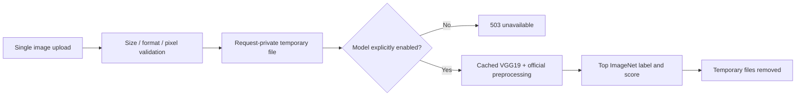

# Tweet image tagger — legacy pretrained-classifier prototype

A Flask API for classifying a single uploaded image with Torchvision's pretrained VGG19 ImageNet model. A legacy route can collect images from a profile-style Twitter/X page, but it is disabled by default and has not been verified against the current site.

This is generic single-label image classification, not a custom-trained tweet-topic model, a social-media sentiment system or a measured recognition benchmark. No model checkpoint or image dataset is bundled.

## Inspect the API without downloading a model

Use Python 3.11+ in an isolated environment for the lightweight path:

```sh
python3 -m venv .venv
source .venv/bin/activate
python -m pip install -r requirements-minimal.txt
flask --app app:flask_app run --host 127.0.0.1
```

`GET /status` reports API availability and whether model/crawler modes are enabled. Importing the app and using health/validation paths does not import Torch/Selenium or download a checkpoint/browser driver. A valid upload returns 503 until a real classifier is explicitly enabled.

```sh
curl -F 'image=@/path/to/synthetic-image.png' http://127.0.0.1:5000/file
```

Uploads accept exactly one PNG/JPEG image, at most 5 MiB and 20 million pixels. The service verifies the image, uses a private temporary directory for that request, and removes it afterward. An uploaded filename cannot choose its filesystem destination. Each request classifies only its own file, rather than every image left by previous users.

A response shape, using illustrative values rather than a measured prediction:

```json
{"predictions":[{"filename":"sample.png","label":"example-class","probability":42.0}]}
```

`probability` retains the old API name but represents a softmax score percentage, not this project's measured accuracy or calibrated real-world certainty.

## Optional model mode

The full `requirements.txt` contains legacy ML pins and was not installed during verification. Prepare a compatible Torch/Torchvision environment deliberately, then set `ENABLE_PRETRAINED_MODEL=true` before starting the server. The first enabled inference may download the large official pretrained checkpoint; review artifact/network/storage needs before opting in.

The implementation uses [Torchvision's VGG19 weights, transforms and category metadata](https://docs.pytorch.org/vision/stable/models/generated/torchvision.models.vgg19.html), caches the CPU model per process, and runs inference without gradient tracking. No training, fine-tuning, evaluation split or custom taxonomy is implemented. The old labels file is retained as legacy context; current inference uses the weight metadata.

## Legacy profile collection

`GET /keyword?keyword=<handle>` historically appends the value to a profile URL; it is not a full keyword-search API. It requires both `ENABLE_LEGACY_CRAWLER=true` and model opt-in, plus `CHROMEDRIVER_PATH` pointing to an already installed trusted driver. Automatic driver installation was removed.

This optional path has an exact HTTPS media-host allowlist, no redirected downloads, per-image byte/time limits, a five-image cap and browser/temp-file cleanup. Site access, current page structure and Selenium compatibility have not been exercised. It can fail or return no images; do not present it as a working current Twitter/X integration.



## Verification and remaining work

```sh
python -m unittest discover -v
```

Seven offline tests pass with Flask/Pillow and an injected synthetic predictor: path traversal prevention, per-request isolation, temporary cleanup, invalid/multiple/oversized images, disabled modes and media-host validation. Health tests confirm Torch and Selenium were not imported. Python sources parse. No pretrained weights, Selenium driver, Twitter/X page, external image or actual inference was downloaded or executed.

The API is unauthenticated and intended for loopback use. Hosting needs authorization, rate/concurrency limits and a worker/resource policy for expensive inference. The full legacy ML/browser environment remains unverified. A reproducible evaluation and a decision to retire or properly redesign profile collection would strengthen this more than calling it a production social-media AI system.
